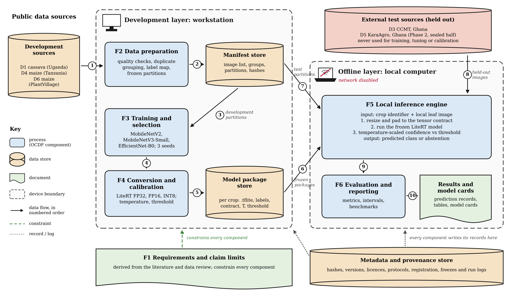

# OCDF: offline cassava and maize leaf-disease classifiers

[](https://github.com/DevaWinner/ocdf-cassava-maize/actions/workflows/ci.yml)


Compact image classifiers that name cassava and maize leaf diseases **on a phone, with no
network connection**, released with everything needed to check, rerun and extend them: the
frozen model files, the full training and evaluation pipeline, a pre-registered study of how
well the models hold up on images from other countries, and an audit trail that ties every
reported number to a hashed record.

| | Cassava | Maize |
|---|---|---|
| Classes | bacterial blight, mosaic disease, healthy | streak virus, northern leaf blight, grey leaf spot, common rust, healthy |
| Model | EfficientNet-B0, LiteRT FP16 | EfficientNet-B0, LiteRT FP16 |
| File size | 7.8 MiB | 7.8 MiB |
| Latency, 1 CPU thread | 20 ms (Galaxy S24) · 86 ms (Pixel 3, 2018) | 20 ms · 86 ms |
| Macro-F1, held-out test from training sources | 0.73 [0.70, 0.76] | 0.96 [0.94, 0.98] |
| Macro-F1, unseen Ghanaian source | 0.56 [0.54, 0.58] (CCMT) | 0.69 [0.67, 0.71] (KaraAgro, sealed test) |

**The main finding is the second row of results.** Accuracy measured on held-out images from
the training sources overstates accuracy on a new source, in every source pair tested, and the
models' confidence does not reveal when this happens. A handful of expert-labelled local images
recovers most of the loss; label-free adaptation on the device does not do so reliably. See
[docs/RESULTS.md](docs/RESULTS.md).

---

## Quick start (two minutes, no GPU, no datasets)

```bash
git clone https://github.com/DevaWinner/ocdf-cassava-maize.git
cd ocdf-cassava-maize
python -m pip install -r requirements.txt

# 1. Diagnose leaf photos offline
python scripts/predict.py --crop cassava examples/images/*.png

# 2. Verify the audit trail: checksums, hash chain and timeline of the pre-registered study
python scripts/verify_artifacts.py

# 3. Recompute every headline result, with confidence intervals, from the saved predictions
python scripts/reproduce_results.py
```

`predict.py` prints the diagnosis, its calibrated confidence and whether the model abstains
("not sure — refer to an expert"). `reproduce_results.py` recomputes ten results from the
per-image predictions and confirms they match the records written when the sealed test was
opened, to the last decimal place.

Use the models from Python:

```python
import sys; sys.path.insert(0, "src")
from ocdf.inference import Classifier

clf = Classifier("maize")                 # frozen model, temperature and threshold; hash-checked
print(clf.predict("leaf.jpg"))            # {'name': ..., 'confidence': ..., 'abstain': ..., 'probabilities': {...}}
```

---

## What is in the repository

```
models/        frozen LiteRT files (.tflite), labels, model card
src/ocdf/      inference, data inventory, grouped partitioning, calibration, evaluation
scripts/       predict.py · verify_artifacts.py · reproduce_results.py
notebooks/     the pipeline, 01 (data acquisition) to 13 (dataset download), as run on Colab
protocol/      pre-registration, freezes, deviations and the sealed-test opening, with SHA-256 hashes
records/       run records of every notebook: manifests, metrics, per-image predictions, benchmarks
bench/         on-device and offline latency benchmarks and their raw results
figures/       result figures and the framework diagrams
data/          dataset sources, licences, label map and how to obtain them
docs/          methods, results, architecture and reproduction guide
tests/         pytest suite run by CI on every push
```

## The framework

OCDF (Offline Crop Diagnosis Framework) has six components. Development runs on a
workstation; inference and evaluation run on an offline device that only ever receives frozen
model packages and held-out images, so no test result can feed back into a development choice.



| Component | Role | Where |
|---|---|---|
| F1 Requirements and claim limits | what the system must do; what may and may not be claimed | [docs/ARCHITECTURE.md](docs/ARCHITECTURE.md) |
| F2 Data preparation | inventory, licences, label map, near-duplicate grouping, partitions | `src/ocdf/inventory.py`, `partition.py`; notebooks 01–02, 06 |
| F3 Training and selection | three architectures × three seeds; pre-declared selection rule | notebooks 03, 07 |
| F4 Conversion and calibration | LiteRT FP32/FP16/INT8; temperature scaling; abstention threshold | `src/ocdf/calibration.py`; notebooks 04, 10 |
| F5 Local inference engine | offline prediction with the frozen package | `src/ocdf/inference.py`, `scripts/predict.py` |
| F6 Evaluation and reporting | metrics, group bootstrap, benchmarks, model cards | `src/ocdf/evaluation.py`; notebooks 05, 08, 09, 11, 12 |

## The study design in brief

- **Data.** Five public sources: cassava from Uganda (Kaggle), maize from Tanzania and
  PlantVillage for development; two Ghanaian sources (CCMT, KaraAgro) for testing only.
  Near-identical photographs are grouped (37,664 groups) and every group stays on one side of
  every split. See [data/README.md](data/README.md).
- **Phase 1.** Train, select, convert, calibrate and freeze; then test once on the internal
  test split and on the unseen Ghanaian CCMT source.
- **Phase 2, pre-registered.** Five hypotheses about why accuracy drops on a new source and
  what can be done on the device, registered with their decision rules before any Phase 2
  experiment, with half of the KaraAgro source sealed and opened once after every choice was
  frozen. See [protocol/README.md](protocol/README.md).

| Hypothesis | Verdict |
|---|---|
| H1 The cross-source drop is general; shift-aimed augmentation reduces it | Supported |
| H2 The drop is caused by background and source cues | Partly supported |
| H3 Label-free adaptation on the device closes the gap (primary endpoint) | **Not confirmed**: −0.059 [−0.079, −0.041] |
| H4 Selective quantisation rescues full-integer INT8 | Not supported |
| H5 Per-class thresholds or the energy score keep abstention working under shift | Not supported |

## Reproducing the work

Three levels, from minutes to days; see [docs/REPRODUCIBILITY.md](docs/REPRODUCIBILITY.md).

1. **Verify** (no data): `verify_artifacts.py` and `reproduce_results.py` as above.
2. **Re-evaluate** (datasets, CPU): download the datasets with notebook 13 and score the
   released `.tflite` files on the frozen test partitions listed in `records/nb02/` and
   `records/nb06/`.
3. **Retrain** (datasets, GPU): run notebooks 01–12 in order on Google Colab. Each notebook
   checks the hashes of its inputs and resumes after interruptions.

## Limitations

- **No Nigerian or other West African farm images with expert labels were available.** Results
  describe Ugandan, Tanzanian, PlantVillage and Ghanaian images; they are not evidence of
  accuracy on any particular farm.
- Labels are taken from the source datasets without independent expert review.
- Maize streak virus images come from one development source and blight, leaf spot and rust
  from another (PlantVillage), so source and class are partly confounded.
- Latency was measured on two hosted Android phones and one laptop, CPU only.
- These are research models, not a diagnostic or advisory service.

## Citation

```bibtex
@software{anietie_2026_ocdf,
  author  = {Anietie, Aniekan Winner},
  title   = {{OCDF}: offline cassava and maize leaf-disease classifiers with a
             pre-registered cross-source evaluation},
  year    = {2026},
  version = {1.0.0},
  url     = {https://github.com/DevaWinner/ocdf-cassava-maize}
}
```

## Licence

Code (`src/`, `scripts/`, `tests/`, `notebooks/`, `bench/`): [MIT](LICENSE).
Models, records, figures and documentation: [CC BY 4.0](LICENSE-CC-BY-4.0.md).
Datasets are not redistributed and keep their own licences ([data/README.md](data/README.md)).
