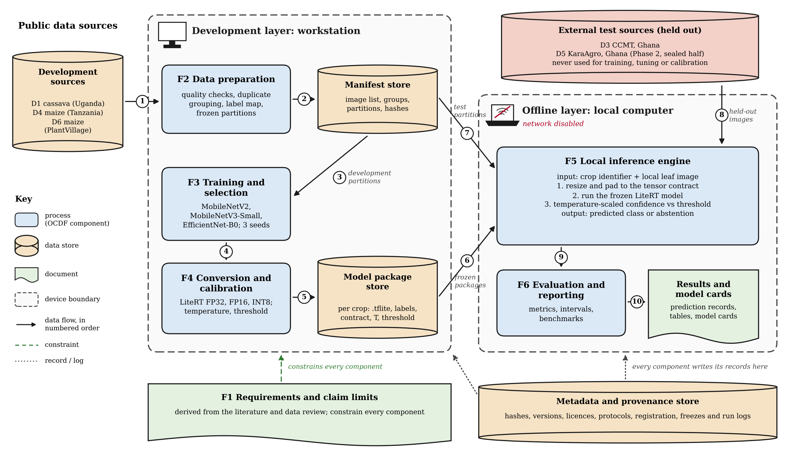

# Architecture: the Offline Crop Diagnosis Framework (OCDF)

OCDF is the system around the models: the components that turn public images into a frozen
on-device package, and the components that run and evaluate that package without a network.



Cylinders are data stores, rounded boxes are processes, wavy-edged shapes are documents, and
the dashed outlines are the two machines. Numbered arrows give the order in which data moves.

## Two machines, one direction of flow

- **Development workstation** (F2–F4): prepares data, trains and selects models, converts and
  calibrates them, and writes frozen packages.
- **Offline device** (F5–F6): network disabled; receives only frozen model packages and
  held-out images; produces predictions, metrics and benchmarks.

Nothing flows back from the offline device to development. A test result therefore cannot
influence a training, selection or calibration choice, which is what makes the test results
trustworthy.

## Components

| | Component | Inputs | Outputs | Implementation |
|---|---|---|---|---|
| F1 | Requirements and claim limits | literature, data availability | requirements; what may and may not be claimed | this documentation; `docs/RESULTS.md` limitations |
| F2 | Data preparation | public datasets | manifest with labels, groups, partitions and hashes | `src/ocdf/inventory.py`, `src/ocdf/partition.py`; notebooks 01, 02, 06 |
| F3 | Training and selection | development partitions | trained Keras models; selection record | notebooks 03, 07 |
| F4 | Conversion and calibration | selected models; calibration partitions | `.tflite` files; temperature; threshold; freeze file | `src/ocdf/calibration.py`; notebooks 04, 10 |
| F5 | Local inference engine | frozen package; images | prediction records | `src/ocdf/inference.py`; `scripts/predict.py` |
| F6 | Evaluation and reporting | prediction records | metrics with intervals; benchmarks; model cards | `src/ocdf/evaluation.py`; notebooks 05, 08, 09, 11, 12; `bench/` |

Two stores run alongside: the **manifest store** (inventories, groups, partitions) and the
**metadata and provenance store** (hashes, versions, licences, protocols, freezes and run
logs), which every component writes to. In this repository they are `records/` and
`protocol/`.

## The frozen package

A deployable package for one crop is: the `.tflite` file, its SHA-256, the class codes in output
order, the temperature T and the abstention threshold, all recorded in a freeze file
(`protocol/frozen_choices_v2.json` for the deployed models). `src/ocdf/inference.py` reads that
record, refuses a model file whose hash does not match, and applies:

```
image (RGB, 0-255) -> resize_with_pad to 224 x 224 (bilinear, zero padding) -> model -> logits
p = softmax(logits / T);  answer = argmax p;  abstain if max p < threshold
```

## Other diagrams

- `figures/workflow.png` — end-to-end workflow
- `figures/inference_sequence.png` — sequence of an offline prediction
- `figures/metadata_er.png` — entities of the metadata and provenance store
- `figures/partitions.png` — how sources map to partitions
