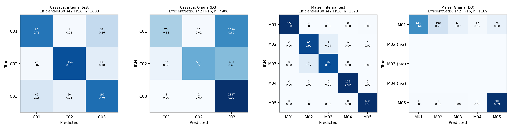
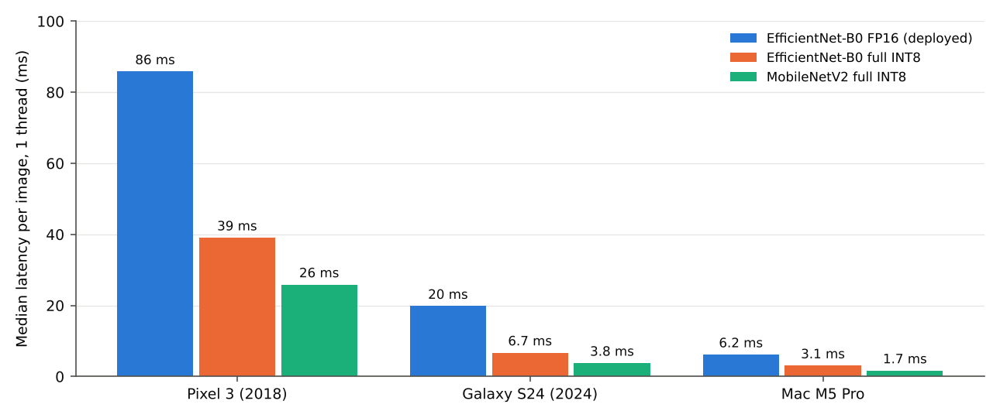
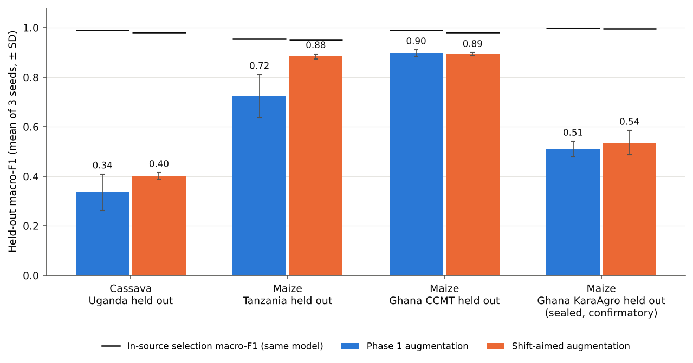
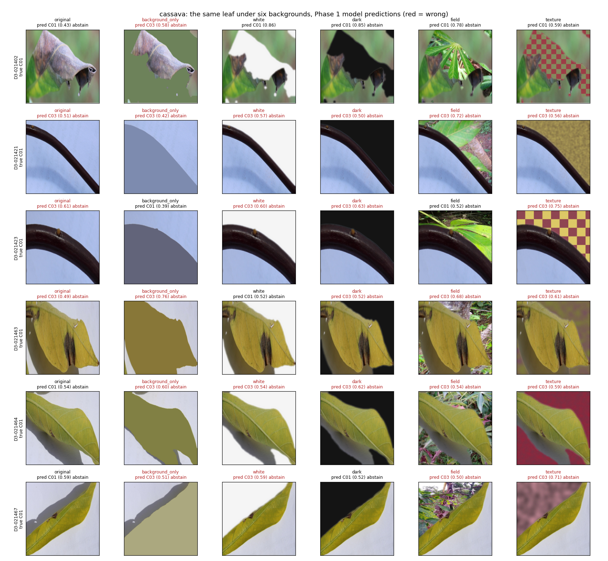
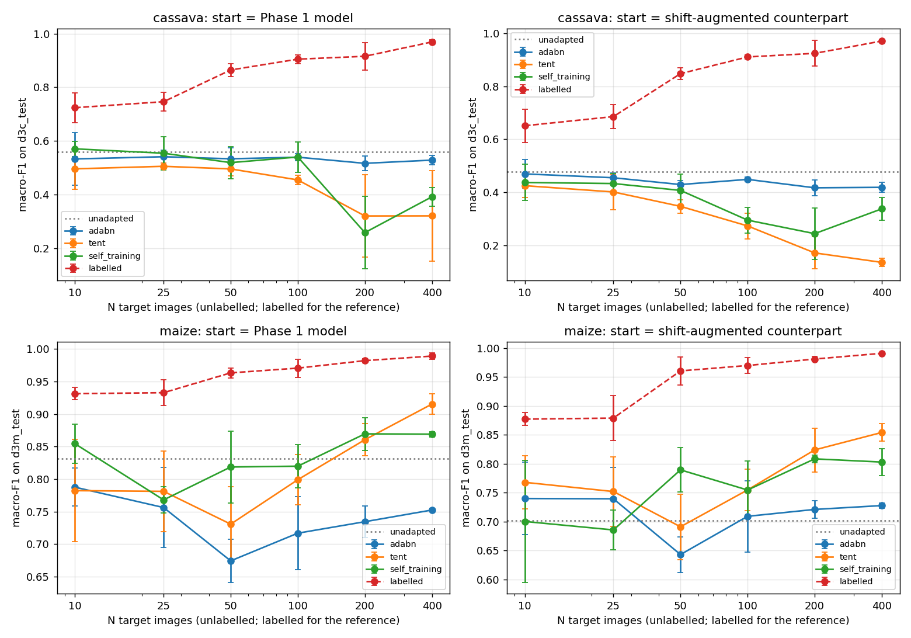

# Results

All numbers below are recomputed by `scripts/reproduce_results.py` or read directly from the
records named beside them. Intervals are 95% percentile intervals from a group bootstrap
(2,000 resamples of whole photo groups, seed 2026). Macro-F1 is averaged over the classes
present in each test set; a prediction of a class absent from that set counts as an error.

**Status labels.** *Confirmatory* results come from the sealed half of KaraAgro, opened once
after every Phase 2 choice was frozen. Everything else is *exploratory*: the CCMT images had
been seen when the Phase 1 results were read.

## Phase 1: the deployed models

Deployed instance: EfficientNet-B0, seed 42, LiteRT FP16 (`models/phase1/`).

| Test set | Cassava macro-F1 | Maize macro-F1 | Record |
|---|---|---|---|
| Internal test (held-out groups, training sources) | 0.728 [0.697, 0.757] | 0.956 [0.935, 0.975] | `records/nb11/final_results.json` |
| CCMT, Ghana (whole source, Phase 1 test) | 0.559 [0.534, 0.587] | 0.809 [0.782, 0.832] | `records/nb05/bootstrap_seed42.csv` |
| CCMT test half (Phase 2 split) | 0.560 [0.540, 0.581] | 0.831 [0.796, 0.860] | `records/nb11/` |
| KaraAgro sealed half, **confirmatory** | — | 0.690 [0.673, 0.707] | `records/nb11/` |

- On Ghanaian images the cassava model found 33% of bacterial-blight leaves (73% at home) and
  called most of the rest healthy; the maize model found about two-thirds of streak-virus leaves on
  CCMT and 77% on KaraAgro (99.5% at home).
- Calibration held at home and broke under shift: expected calibration error rose from 0.02
  (internal) to 0.21 (cassava, CCMT).
- **Compression.** FP16 gave identical predictions to FP32 on every test (paired difference
  0.000). Full-integer INT8 lost 9.6 points of cassava accuracy on the internal test
  [7.8, 11.4] and failed the pre-declared budget, so FP16 was deployed (`records/nb05/bootstrap_seed42.csv`).

## On-device latency

Median of 100 runs, one CPU thread, LiteRT; phones hosted by Qualcomm AI Hub, laptop offline
with Wi-Fi off (`bench/`, `records/nb12/`).

| File | Size | Galaxy S24 (Snapdragon 8 Gen 3) | Pixel 3 (Snapdragon 845) | Apple M5 Pro laptop |
|---|---|---|---|---|
| EfficientNet-B0 FP16 (deployed) | 7.8 MiB | 19.8 ms | 85.8 ms | 6.2 ms |
| EfficientNet-B0 full INT8 | 4.7 MiB | 6.7 ms | 39.1 ms | 3.1 ms |
| MobileNetV2 full INT8 (comparator) | 2.6 MiB | 3.8 ms | 25.9 ms | 1.7 ms |

Cassava files shown; maize files are within 1 ms on the S24 and within 4 ms on the Pixel 3.

## Phase 2: five pre-registered hypotheses

### H1 — the cross-source drop is general. **Supported.**

Leave-one-source-out training; held-out macro-F1, mean of three seeds
(`records/nb07/e11_transfer_matrix.csv`, `records/nb11/`).

| Held-out source | In-source | Phase 1 augmentation | Shift-aimed augmentation |
|---|---|---|---|
| Cassava: Uganda (trained on Ghana) | 0.99 | 0.336 | 0.401 |
| Maize: Tanzania | 0.95 | 0.723 | 0.884 |
| Maize: CCMT | 0.99 | 0.897 | 0.893 |
| Maize: KaraAgro (sealed, secondary confirmatory) | 1.00 | 0.510 | 0.535 |

Every held-out source scored well below in-source accuracy (losses of 0.09 to 0.65).
Shift-aimed augmentation (random resized crop, colour jitter, random erasing, CutMix) cut the
Tanzanian loss from 0.23 to 0.07 on every seed, helped slightly on KaraAgro (+0.025), and made
no difference on CCMT.

### H2 — background and source cues cause the drop. **Partly supported.**

In CCMT, 89% of healthy cassava photographs were taken on paper, against 48% of blight and 42%
of mosaic photographs: a label-correlated background. Holding each paper-background leaf fixed
and replacing only its background (`records/nb08/`), plain backgrounds changed 6–7% of the
Phase 1 model's predictions and a Ugandan field background 23%, but blight and mosaic recall
stayed low under every background. The background contributes; most of the loss lies in how the
disease itself looks in the new source.

### H3 — label-free adaptation on the device closes the gap. **Not confirmed (primary endpoint).**

Three label-free methods (AdaBN, Tent, gated self-training) and a labelled reference were run
with 10 to 400 local images (`records/nb09/`). The registered rule chose Tent with 400 images
from the CCMT maize curves (0.83 → 0.92). On the sealed KaraAgro half:

| Draw (400 unlabelled images) | Unadapted | Adapted | Paired difference [95% CI] |
|---|---|---|---|
| Registered draw | 0.691 | 0.632 | **−0.059 [−0.079, −0.041]** |
| Sensitivity draw 2 | 0.691 | 0.750 | +0.059 [+0.042, +0.076] |
| Sensitivity draw 3 | 0.691 | 0.817 | +0.126 [+0.108, +0.144] |

The same method and image count helped or hurt depending on which images the device happened to
hold. For cassava every label-free method lowered macro-F1 on every draw, while ten
expert-labelled local images raised it from 0.56 to 0.72, and 400 to 0.97.

### H4 — selective quantisation rescues INT8. **Not supported.**

The LiteRT quantisation debugger located the largest errors in the squeeze-and-excitation
layers (worst in block 4b), but keeping up to 40 of the worst operations in float still left a
loss of about 10 points of cassava accuracy (`records/nb10/`). Quantisation-aware training is the
untested next step.

### H5 — abstention still works under shift. **Not supported.**

Separating unfamiliar inputs (cassava brown spot and green mite; cashew and tomato leaves) from
familiar shifted images: AUROC 0.52 for cassava and 0.63 for maize with the maximum softmax
probability; the energy score was no better, and its maize rule rejected 93% of KaraAgro and
86% of CCMT leaves. A confidence score did not tell the models they had left their training
distribution (`records/nb11/final_results.json`, `h5_familiar_vs_unfamiliar`).

## A lesson about model selection

The pre-declared rule for Phase 2 chose the shift-augmented models because they matched the
Phase 1 models on in-source selection data. On every shifted test set they were worse by 0.08 to
0.15 macro-F1 (KaraAgro: 0.537 against 0.690). A selection rule that sees only in-source data
cannot see transfer; selection should include a held-out foreign source.

## What this means for deployment

1. The models are small and fast enough for low-end phones; speed is not the constraint.
2. Accuracy on a new source cannot be inferred from accuracy at home, and the models' confidence
   gives no warning.
3. Before deployment in a new region, collect a small set of expert-labelled local images: tens
   per class recovered most of the loss here, and unlabelled adaptation did not.
